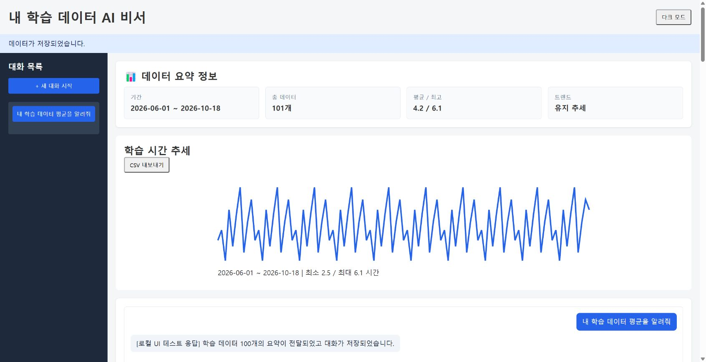
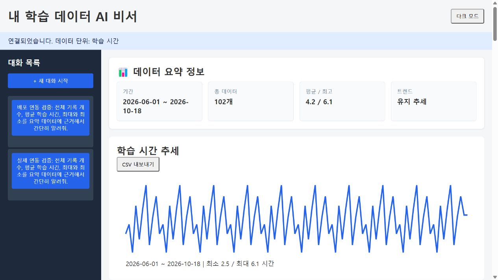
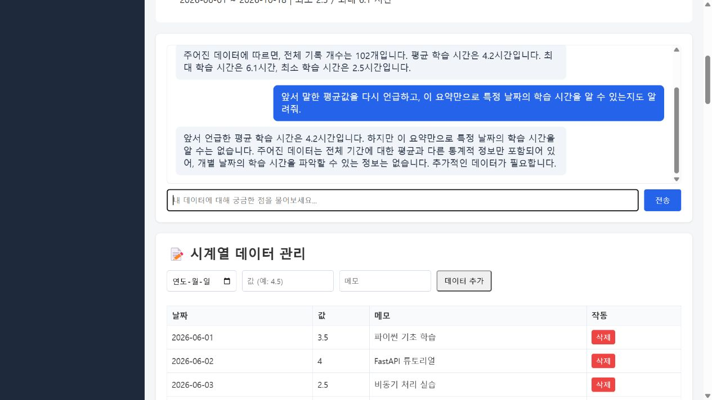
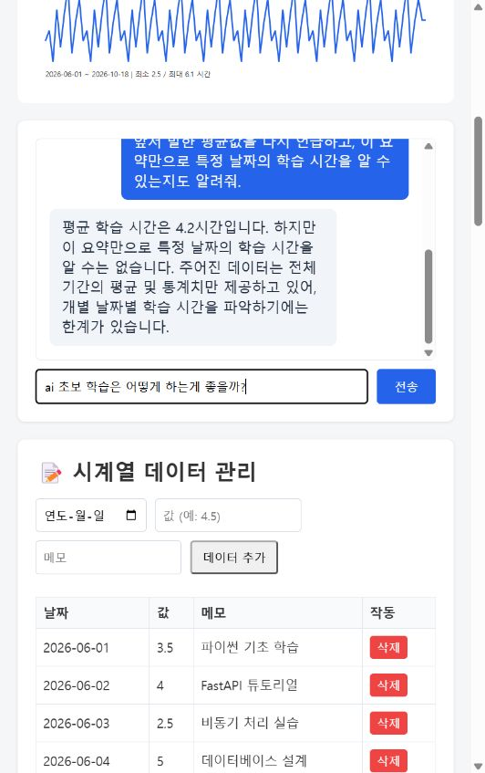

# 📊 내 학습 데이터를 아는 AI 비서

학습 기록을 저장하고, **실제 통계에 기반한 답변**을 받는 웹 서비스입니다.
100개의 학습 시간 예시 데이터로 시작해 내 기록을 추가하고 이전 대화를 이어갈 수 있습니다.

**FastAPI · Pydantic · Firestore · OpenAI GPT · Vanilla JavaScript**

| 기능 | 구현 내용 |
| --- | --- |
| 데이터 관리 | 날짜·값·메모 CRUD API, 화면에서 추가·조회·삭제 |
| 데이터 분석 | 기간·개수·합계·평균·최대·최소·표준편차, 전·후반 평균 비교 추세 |
| AI 채팅 | 요약을 시스템 프롬프트에 주입, 로딩 표시, 성공한 대화 자동 저장 |
| 대화 복원 | 목록과 상세 조회, 이전 대화 불러오기 |
| 편의 기능 | SVG 추세 그래프, CSV 내보내기, 다크 모드 |


<details>
<summary>화면 미리보기 · 로컬 UI 검증</summary>



샘플 데이터와 모의 GPT 응답으로 확인한 화면입니다. 실제 배포 증빙은 아닙니다.
</details>

## 구조와 코드 규칙

```text
app/
  main.py              # 앱 · CORS · 예외 처리
  config.py            # 환경 변수 · 지연 Firebase 초기화
  models.py            # 요청 검증
  routers/             # data · conversations · chat
  services/analyzer.py # 순수 통계 계산
frontend/              # HTML · CSS · JavaScript · Vercel 설정
scripts/seed.py         # 100개 샘플 가져오기
seed_data.json         # 학습 시간 예시 데이터, 단위: 시간
tests/                # 외부 호출 없는 동작 테스트
render.yaml            # Render 실행 설정
```

중복된 backend/를 루트 app/으로 통합했습니다. Python은 **PEP 8**,
79자 줄 길이, snake_case, import 그룹 정렬을 Ruff로 검사합니다.
라우터는 HTTP·저장을, 서비스는 계산을 담당합니다.

## 로컬 실행

Python 3.10 이상에서 저장소 루트를 기준으로 실행합니다.

```bash
git clone https://github.com/ljk-cidy/M1-2.git
cd M1-2
python -m venv .venv
# Windows: .venv\Scripts\activate
# macOS/Linux: source .venv/bin/activate
python -m pip install -r requirements.txt
```

.env.example을 .env로 복사하고 키를 설정한 다음, 웹과 API를 함께 실행합니다.

```bash
python -m scripts.run_local
```

이 터미널을 열어 두세요. Ctrl+C는 두 서버를 종료합니다. PC나 앱 실행 세션이
종료되면 로컬 서버도 중지되므로 다시 명령을 실행해야 합니다. 포트가 이미 사용
중이면 기존 서버를 먼저 확인하세요. 항상 접속하려면 아래 배포 URL을 사용합니다.

개별 실행이 필요할 때는 아래 명령을 사용합니다. 샘플 적재는 최초 준비 시에만
선택적으로 실행하며, 서버를 켤 때마다 실행할 필요가 없습니다.

```bash
python -m scripts.seed
python -m uvicorn app.main:app --reload
```

다른 터미널에서 프론트엔드를 엽니다. 로컬 API 주소는 자동 적용됩니다.

```bash
python -m http.server 5500 --directory frontend
```

[웹 화면](http://localhost:5500) · [Swagger](http://127.0.0.1:8000/docs)

샘플은 2026-06-01부터 100일간의 학습 시간 예시입니다. 가져오기를 다시 실행하면
sample-000 등의 고정 ID를 덮어씁니다. 실제 기록은 별도 ID로 저장됩니다.
키가 없어도 앱과 /docs는 열리며, 데이터 요청은 503으로 설정 누락을 알려줍니다.

## 환경 변수

| 변수 | 위치 | 용도 |
| --- | --- | --- |
| OPENAI_API_KEY | 백엔드 | GPT 인증 |
| OPENAI_MODEL | 백엔드 | 기본 gpt-4o-mini |
| FIREBASE_SERVICE_ACCOUNT_JSON | 백엔드 | 서비스 계정 JSON 문자열 |
| GOOGLE_APPLICATION_CREDENTIALS | 백엔드 | JSON 문자열 대신 사용할 로컬 키 파일 경로 |
| ALLOWED_ORIGINS | 백엔드 | 쉼표로 구분한 프론트엔드 도메인 |
| API_BASE_URL | Vercel 빌드 | Render API 주소, 마지막 / 없이 입력 |

로컬은 루트 serviceAccountKey.json도 지원합니다. 키·.env·생성된 config.js는
Git에서 제외합니다. API_BASE_URL은 공개 설정이며 비밀 키를 넣지 않습니다.

## API

| 경로 | 메서드 | 동작 |
| --- | --- | --- |
| /api/data | GET · POST | 목록 · 추가 |
| /api/data/{id} | PUT · DELETE | 일부 필드 수정 · 삭제 |
| /api/data/summary | GET | 통계 요약 |
| /api/conversations | GET · POST | 목록(messages 포함) · 저장 |
| /api/conversations/{id} | GET · DELETE | 전체 대화 · 삭제 |
| /api/chat | POST | 요약 기반 답변 · 자동 저장 |

날짜·유한한 수치·메시지 역할·길이를 검증하고 잘못된 요청은 422로 반환합니다.
GPT에는 최근 20개 메시지와 요약을 전달하며, 응답은 최대 500토큰으로 제한합니다.
100개 메시지에 도달하면 새 대화를 안내합니다. OpenAI 자동 재시도는 끕니다.

## 배포

| 대상 | 설정 | 확인 상태 |
| --- | --- | --- |
| Render | 저장소 루트, Python 3.14.7 · Free | [백엔드 API](https://m1-2-tmp4.onrender.com) |
| Vercel | frontend · Other · API_BASE_URL 적용 | [웹 서비스](https://m1-2-frontend-psi.vercel.app) |
| Swagger | 배포 API 문서 | [Swagger UI](https://m1-2-tmp4.onrender.com/docs) |

Vercel은 node build.mjs로 공개 API 주소를 config.js에 주입합니다.
Render의 ALLOWED_ORIGINS에 https://m1-2-frontend-psi.vercel.app을 적용했습니다.
첫 요청의 서버 시작 지연은 화면에 안내하며, 요청은 90초까지 기다립니다.

현재 인증·사용자별 데이터 분리는 없습니다. 공개 배포에서는 모든 방문자가 동일한
데이터를 읽고 수정하며 GPT 호출을 발생시킬 수 있으므로 개인 학습용으로 사용합니다.
CORS는 인증을 대신하지 않습니다.

2026-10-18 실제 Firestore 검증: **101개**(학습용 예시 100개 + 기존 기록 1개).
추가 데이터는 10일 패턴이 반복되는 예시이며, 실제 관측 기록이 아닙니다.
검증 결과는 [데이터 점검 보고서](docs/data-audit.md)를 참고하세요.

## 검증과 제출

```bash
python -m pip install -r requirements-dev.txt
ruff check app scripts tests
ruff format --check app scripts tests
python -m unittest discover -v
```

CRUD·입력 검증·대화 복원·컨텍스트 주입·자동 저장·실패 시 미저장·요약 경계값을
외부 API 호출 없이 검증합니다. 실제 Firestore/GPT 연동 및 새로고침 후 대화 복원까지 확인했습니다. Render·Vercel 배포에서도 데이터 조회·CORS·실제 GPT 2회 호출·저장·웹 복원을 확인했습니다.

실제 Render·Vercel 서비스에서 데이터 조회와 대화 복원을 확인한 화면입니다.





로컬 실제 GPT 검증 화면:



제출 증빙 준비 상태:

- [x] 로컬 실제 GPT 질문·답변 및 요약 API 수치 대조
- [ ] 요약 카드와 질문·답변이 함께 보이는 최종 제출 화면
- [ ] 데이터 추가 또는 삭제 결과
- [x] 로컬 실제 대화 저장 및 새로고침 후 불러오기
- [x] 프론트·백엔드·Swagger 실제 배포 URL

선택 과제 중 그래프·표준편차·CSV·다크 모드는 구현했습니다.
Function Calling 및 MCP/GPT Actions 연동은 미구현입니다.
